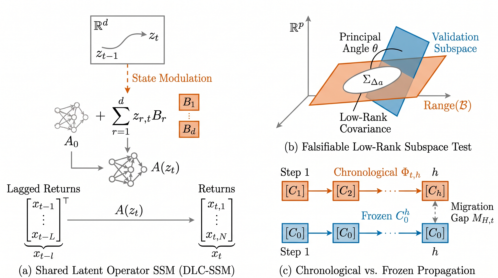

# Testing a Shared Low-Dimensional Operator Representation

Research code for *Testing a Shared Low-Dimensional Operator Representation for Time-Varying Financial Dynamics* by Jiyu Mo and Dongyang Kuang. It tests whether time-varying sector-return operators can be represented by a shared low-dimensional latent state, and studies the resulting propagation geometry and five-day downside prediction.

## 🧭 Mechanistic overview



**Figure 1. Mechanistic overview of the Shared Low-Dimensional Operator State-Space Model (DLC-SSM) and its two separate diagnostic frameworks.** (a) **Shared Latent Operator SSM:** Observed covariates $u_t$ drive a $d$-dimensional latent state $z_t \in \mathbb{R}^d$, which modulates a shared basis $\lbrace B_r\rbrace_{r=1}^d$ over a screened sparse support to form time-varying sector interaction operators $A(z_t) = A_0 + \sum_{r=1}^d z_{r,t} B_r$, mapping lagged sector returns $x_{t-l}$ to $x_t$. (b) **Falsifiable Low-Rank Subspace Test (Propositions 1–2):** Under the affine operator hypothesis, coefficient-increment covariance $\Sigma_{\Delta a}$ has rank $d$ and lies within the invariant subspace $\text{Range}(\mathcal{B}) \subset \mathbb{R}^p$; empirical validity is tested via principal angles ($\theta$) and projector distances against unrestricted cross-window subspaces. (c) **Chronological vs. Frozen Propagation (Proposition 3 & Corollary 1):** Finite-horizon propagation under the time-ordered operator product $\Phi_{t,h} = C_h \cdots C_1$ diverges from the forecast-origin frozen approximation $C_0^h$, inducing a migration gap $M_{H,t}$ bounded by cumulative latent-state movement $\sum_{m=1}^h \lVert z_{t+m} - z_t\rVert_2$. Solid orange arrows denote latent state modulation and time-varying operator evolution; solid blue arrows denote baseline/frozen pathways.

The public repository contains the experiment code, configurations and documentation. Raw Tushare data, full local outputs and the manuscript working directory are not part of the public release. The post-acceptance S5 ten-seed extension and OOS block sensitivity have been verified in the local research workspace; [the reproducibility guide](docs/REPRODUCIBILITY.md#post-acceptance-supplement-experiments) explains how to generate and check those results independently. These later checks are separate from results reported in the published paper.

## 🔬 Scientific scope

- Tushare-first A-share sector data pipeline using SW industry classification and SW daily data.
- Strict Train / Validation / Test isolation with train-only standardization and causal screening.
- Train-only bootstrap directional support discovery: the main configuration uses multivariate lagged Lasso stability selection; optional LPCMCI is a separate sensitivity branch.
- Gaussian DLC-SSM with a shared low-dimensional learned operator subspace.
- Penalized generalized-EM:
  - time-varying Kalman filter;
  - RTS smoother for training only;
  - exact Gaussian latent-moment observation normal equations;
  - sparse-group proximal update on admissible directed lag edges.
- HMM baseline with **manual forward-only filtered probabilities** (no smoothed test labels).
- Companion-operator propagation:
  - pair response / path energy;
  - transmitter, receiver, net-transmitter;
  - reachability Gramian;
  - spectral radius, non-normality, finite-horizon transient gain;
  - frozen vs pathwise propagation and state-migration gap;
  - analytic state-to-multistep sensitivity;
  - directional reversal boundaries and analytic posterior sign probabilities.
- Posterior predictive uncertainty propagation.
- Synthetic DGPs that favor both the proposed model and competing mechanisms.
- Downside-risk evaluation with nested M0--M5 held-out comparisons.
- CI, lint configuration, contribution guide, data card, reproducibility instructions, and theory tests.

## 📚 Documentation

| Document | Contents |
|---|---|
| [`docs/METHODS.md`](docs/METHODS.md) | Mathematics, algorithms, API, extension contracts, baselines, OOS design and limitations |
| [`docs/PAPER_TO_CODE.md`](docs/PAPER_TO_CODE.md) | Published-paper components mapped to code, configuration and evidence |
| [`docs/REPRODUCIBILITY.md`](docs/REPRODUCIBILITY.md) | Installation, execution, data access, release scope, troubleshooting and supplement runbook |
| [`paper_supplement/MATHEMATICAL_DERIVATIONS.md`](paper_supplement/MATHEMATICAL_DERIVATIONS.md) | Detailed derivations of the paper's propositions, corollary, estimation equations and diagnostics |
| [`paper_supplement/ROBUSTNESS_AND_UNCERTAINTY_RESULTS.md`](paper_supplement/ROBUSTNESS_AND_UNCERTAINTY_RESULTS.md) | Robustness and uncertainty analyses and their interpretation |
| [`data/README.md`](data/README.md) | Data source, variables, frozen split, leakage controls and redistribution limits |
| [`THIRD_PARTY_NOTICE.md`](THIRD_PARTY_NOTICE.md) | Dependency attribution and financial-data terms |
| [`SECURITY.md`](SECURITY.md) | Security reporting and accidental-disclosure policy |
| [`CODE_OF_CONDUCT.md`](CODE_OF_CONDUCT.md) | Community participation and contribution standards |

The two files under `paper_supplement/` are part of the documentation set: `MATHEMATICAL_DERIVATIONS.md` expands the paper's mathematical arguments without changing the manuscript, while `ROBUSTNESS_AND_UNCERTAINTY_RESULTS.md` records the post-acceptance numerical robustness and uncertainty evidence.

Conventions used throughout the repository:

- Files under `config/` are the source of truth; do not hide seeds, lags, thresholds, state dimensions or penalties in ad-hoc flags.
- Every cited run needs its own output directory. Failed and unsupported cells stay in the ledger and are never silently replaced.
- Unit tests and smoke runs check implementation behavior; empirical evidence is identified by its recorded configuration, output and verification status.
- Before copying any table or figure into a manuscript, complete the [reproducibility guide](docs/REPRODUCIBILITY.md).

## 🗂️ Repository layout

Main directories and entry points:

```text
.
├── config/
│   ├── data.yaml
│   ├── causal.yaml
│   ├── dlcssm.yaml
│   ├── baselines.json
│   ├── oos_final.json
│   └── oos_predictive.json
├── data/
│   ├── raw/
│   ├── interim/
│   └── processed/
├── src/
│   ├── cli.py                  # command-line entry point
│   ├── core/                   # infrastructure: config, data, stats, contracts
│   ├── model/                  # DLC-SSM, Kalman/EM, propagation, geometry
│   ├── baselines/              # VAR, connectedness, HMM, fixed-network
│   ├── causal/                 # train-only support screening
│   ├── oos/                    # nested M0--M5 out-of-sample evaluation
│   └── experiments/            # benchmark, ablation, and geometry runners
├── tests/
├── docs/
│   └── assets/                   # documentation figures and other static assets
├── paper_supplement/
│   ├── MATHEMATICAL_DERIVATIONS.md
│   └── ROBUSTNESS_AND_UNCERTAINTY_RESULTS.md
├── scripts/run_main.py         # staged publication experiment runner
├── outputs/
└── .github/workflows/ci.yml
```

## 🛠️ Installation

Python 3.10+ is required by the package metadata. From the repository root, create a virtual environment and install the experiment dependencies. On Windows PowerShell:

```powershell
py -3 -m venv .venv
.\.venv\Scripts\python.exe -m pip install -e ".[dev,hmm]"
.\.venv\Scripts\python.exe -m pytest -q
```

On a POSIX shell, use `python3 -m venv .venv`, then `.venv/bin/python -m pip install -e ".[dev,hmm]"` and `.venv/bin/python -m pytest -q`. Install `.[causal]` only for the optional LPCMCI branch. The default `linear_lasso` support configuration does not require Tigramite.

The CLI can be invoked either as `dlcssm ...` after installation or as `python -m cli ...` from the repository root.

## 🗃️ Tushare data

Never hard-code your token. Put it in the environment:

```powershell
$env:TUSHARE_TOKEN = "<your token>"
```

The default pipeline uses:

- `index_classify` to resolve SW 2021 Level-1 sectors;
- `sw_daily` for sector daily market data;
- `index_daily` for the CSI 300 broad-market return;
- optional `fx_daily` for USD/CNH when enabled.

Tushare permissions depend on the user's account. Raw Tushare data are intentionally excluded from git. Users are responsible for complying with Tushare's data terms and redistribution restrictions.

Download and prepare:

```bash
dlcssm download --config config/data.yaml
dlcssm prepare --config config/data.yaml
```

The prepared dataset is written to `data/processed/dataset.npz` plus auditable metadata.

## 🔒 Strict OOS discipline

The default frozen split is:

- Train: 2014-03-01 ... 2019-12-31
- Validation: 2020-01-01 ... 2022-12-31
- Test: 2023-01-01 ... 2026-08-31

The code enforces:

1. causal support is learned from Train only;
2. standardization parameters are learned from Train only;
3. hyperparameters are selected using Validation only;
4. test state inference uses the Kalman **filter only**;
5. smoother output is blocked from test-facing helpers;
6. future-state pathwise geometry must come from the transition model, not future filtered/smoothed states.

## 📐 OOS factor and five-day target definitions

This section records the calculation contract used by the current OOS design. It is intended to make the expanded dynamic-state factors and the five-day downside target directly reproducible from the code.

### Timing and operator notation

Let $x_t\in\mathbb{R}^N$ denote the sector-return vector and let $\mathcal I_t$ contain information available through date $t$. The DLC-SSM uses the state-dependent VAR coefficients

$$
A_\ell(z_t)=A_{0,\ell}+\sum_{r=1}^{d}z_{t,r}B_{r,\ell},
\qquad \ell=1,\ldots,L,
$$

and their $NL\times NL$ companion matrix $C_t=C(z_t)$. The state used at an OOS origin is the forward-filtered posterior $z_t\mid\mathcal I_t\sim\mathcal N(\hat z_t,P_t)$; no smoothed state is used. Let $J=[I_N,0,\ldots,0]$ select the contemporaneous sector block, and let $\lVert\cdot\rVert_2$ and $\lVert\cdot\rVert_F$ denote the spectral and Frobenius norms.

### Five-day downside target

For the raw broad-market simple return $r_t^{mkt}$, the target attached to origin $t$ is the *future* downside semivariance

$$
Y_{t,H}=\frac{1}{H}\sum_{h=1}^{H}
\left[\min\negthinspace\left(r_{t+h}^{mkt},0\right)\right]^2,
\qquad H=5.
$$

Thus the label uses exactly the next five trading observations $t+1,\ldots,t+5$, not the preceding five-day window. Positive returns contribute zero; negative returns contribute their squared magnitude. The quantity is nonnegative and is neither a drawdown nor expected shortfall. Labels whose five-day horizon crosses a Train/Validation/Test boundary are excluded. The implementation reconstructs the raw market return before forming the label; standardized returns are not used in this equation.

### Nested M0--M5 factor blocks

Each model contains all factors in the preceding model:

| Model | Newly added factors |
|---|---|
| M0 | Market return, realized volatility, average sector correlation, turnover proxy |
| M1 | $K-1$ filtered HMM regime probabilities; $K=3$ by default |
| M2 | Five-step Diebold--Yilmaz connectedness and TVP-VAR innovation risk |
| M3 | Spectral radius, companion nonnormality, and frozen-operator peak gain |
| M4 | Posterior-predictive state-migration gap |
| M5 | State susceptibility of discounted off-diagonal propagation energy |

#### M0: observable controls

The broad-market return is $r_t^{mkt}=P_t/P_{t-1}-1$. With the default window $w=20$, realized volatility is

$$
RV_t=\sqrt{252}\thickspace\mathrm{sd}
\left(r_{t-w+1}^{mkt},\ldots,r_t^{mkt}\right),
$$

using the sample standard deviation. Average correlation is the mean of all distinct pairwise Pearson correlations in the trailing 20-row sector-return window,

$$
\bar\rho_t=\frac{2}{N(N-1)}\sum_{i<j}
\mathrm{corr}\negthinspace\left(x_{i,t-w+1:t},x_{j,t-w+1:t}\right).
$$

The turnover proxy is the cross-sector median of `amount / float_mv` on date $t$. If floating market value is unavailable, the data builder uses the cross-sector median of `log1p(amount)` instead.

#### M1: filtered HMM regime probabilities

For HMM state $s_t\in\lbrace1,\ldots,K\rbrace$, the factor is the one-sided filtered probability

$$
p_{t,k}=\Pr(s_t=k\mid\mathcal I_t),\qquad k=1,\ldots,K-1.
$$

Only $K-1$ probabilities enter the regression because the probabilities sum to one and the regression includes an intercept. These are close-$t$ filtered probabilities, not backward-smoothed probabilities.

#### M2: conventional dynamic benchmarks

For current TVP-VAR coefficients $A_{t,\ell}$, define $\Psi_{t,0}=I_N$ and

$$
\Psi_{t,h}=\sum_{\ell=1}^{\min(L,h)}
A_{t,\ell}\Psi_{t,h-\ell}.
$$

With innovation covariance $\Sigma$, the generalized forecast-error variance share is

$$
\theta^{raw}_{ij}(H)=
\frac{\sigma_{jj}^{-1}\sum_{h=0}^{H-1}
(e_i^\top\Psi_{t,h}\Sigma e_j)^2}
{\sum_{h=0}^{H-1}e_i^\top\Psi_{t,h}\Sigma\Psi_{t,h}^\top e_i},
\qquad
\tilde\theta_{ij}=\frac{\theta^{raw}_{ij}}
{\sum_j\theta^{raw}_{ij}}.
$$

The exported Diebold--Yilmaz factor is the total connectedness index

$$
TCI_t(H)=\frac{100}{N}\sum_i\sum_{j\ne i}\tilde\theta_{ij}(H).
$$

The TVP innovation-risk factor is the mean-sector $H$-step forecast-error variance in raw return-squared units,

$$
R_t^{TVP}(H)=\frac{1}{N}\mathrm{tr}\negthinspace\left[
\sum_{h=0}^{H-1}\Psi_{t,h}\Sigma\Psi_{t,h}^{\top}\right].
$$

It freezes the current TVP coefficients over the horizon and does not include future coefficient uncertainty.

#### M3: frozen state-dependent operator geometry

At the filtered state mean, set $C_t=C(\hat z_t)$. The three M3 factors are

$$
\rho_t=\max_j|\lambda_j(C_t)|,
$$

$$
\nu_t=\frac{\lVert C_t^\top C_t-C_tC_t^\top\rVert_F}
{\lVert C_t\rVert_F^2+10^{-12}},
$$

and

$$
G_t^{fr}(H)=\max_{1\le h\le H}\lVert C_t^h\rVert_2.
$$

The gain is computed on the full companion operator and keeps the state fixed at its origin value; it is not the gain along a predicted changing-state path.

#### M4: posterior-predictive state-migration gap

For draw $b$, first sample $z_t^{(b)}\sim\mathcal N(\hat z_t,P_t)$, then propagate

$$
z_{t+h}^{(b)}=Fz_{t+h-1}^{(b)}+Gu_t+q_{t+h}^{(b)},
\qquad q_{t+h}^{(b)}\sim\mathcal N(0,Q),
$$

where the current standardized covariate $u_t$ is persisted over all futuresteps. Define

$$
\Phi_{t,h}^{(b)}=C(z_{t+h}^{(b)})\cdots C(z_{t+1}^{(b)}),
$$

and the draw-level migration gap

$$
M_t^{(b)}(H)=\max_{1\le h\le H}
\left\lVert\Phi_{t,h}^{(b)}-C(z_t^{(b)})^h\right\rVert_2.
$$

The M4 regression factor is $B^{-1}\sum_{b=1}^{B}M_t^{(b)}(H)$, with $B=256$ by default. The norm and maximum are taken separately within each path before averaging. This posterior-predictive uncertainty includes filtered-state and future process uncertainty conditional on fitted parameters; it does not include parameter estimation uncertainty.

#### M5: state susceptibility

Let $C_r=\partial C(z)/\partial z_r$ and $D_{r,h}=\partial C_t^h/\partial z_r$. The exact recurrence used in the code is

$$
D_{r,0}=0,\qquad
D_{r,h}=C_rC_t^{h-1}+C_tD_{r,h-1}.
$$

For response $R_h=JC_t^hJ^\top$, define discounted pairwise propagation energy and its derivative by

$$
E_{ij}=\sum_{h=1}^{H}\delta^{h-1}(R_h)_{ij}^2,
\qquad
\frac{\partial E_{ij}}{\partial z_r}
=2\sum_{h=1}^{H}\delta^{h-1}(R_h)_{ij}
\left(JD_{r,h}J^\top\right)_{ij}.
$$

The scalar M5 factor is the Frobenius norm of the off-diagonal normalized sensitivities,

$$
S_t(H)=\left\lVert
\left\lbrace\frac{\partial E_{ij}/\partial z_r}{\epsilon+E_{ij}}
\right\rbrace_{r,\thinspace i\ne j}\right\rVert_F,
$$

with $\delta=0.95$ and $\epsilon=10^{-10}$ by default.

All factors are aligned on a common available-row sample. Degenerate columns are screened using Train only, and retained columns are standardized using Train means and standard deviations; the same transform is then applied to Validation and Test. The default constants above are declared in [`config/oos_final.json`](config/oos_final.json), and the feature construction is implemented in [`src/oos/oos_final.py`](src/oos/oos_final.py).

## ▶️ Quick start and full experiment

The offline quick check needs no financial-data credentials:

```powershell
.\.venv\Scripts\python.exe -m cli theory-checks
.\.venv\Scripts\python.exe -m cli synthetic --scenario shared_low_rank --output outputs/checkpoints/synthetic_demo.npz
```

For the full paper experiment, obtain authorized Tushare data and prepare `data/processed/dataset.npz` first. The publication runner is `scripts/run_main.py` with `config/main_runner.json`; it requires substantially more work than the quick check. Exact stage order, output checks and limitations are in [Reproducibility](docs/REPRODUCIBILITY.md). Use a new output root for a scientifically changed configuration.

## ✅ Theory checks

`tests/` contains direct numerical checks for:

1. gauge invariance of the induced operator path;
2. low-rank coefficient-variation/operator-subspace implication;
3. analytic matrix-power/state sensitivity against finite differences;
4. exact frozen-vs-pathwise telescoping decomposition to near machine precision.

Additional tests cover filtered-state no-future-leakage, reversal sign probability, and data splitting.

## 🧭 Causal-support semantics

The causal-discovery layer is an **admissible directional support screen**, not a claim that every nonzero state-space coefficient is an independently identified structural causal effect.

The paper's primary real-data and synthetic branches use `linear_lasso` predictive screening. LPCMCI is kept as a separate sensitivity branch:

```yaml
method: lpcmci
```

and requires `.[causal]`. Neither support is a structural graph: the linear-Lasso branch defines predictive directions, and LPCMCI screens directionally admissible candidates. Results from one branch must not be reported as the other.

## 🔁 Reproducibility

- All seeds, lags, block lengths, thresholds, state dimensions, and penalties are configurationvalues.
- Every prepared dataset has a metadata JSON payload with split and scaler parameters.
- Raw/interim/processed financial data and experiment outputs are ignored by git.
- Synthetic experiments can run fully offline.
- See [Methods](docs/METHODS.md) and [Data and provenance](data/README.md).

## 📄 Citation and license

Code: Apache-2.0. Data: **not included**; source-specific data licenses/terms still apply. See [LICENSE](LICENSE), [third-party notices](THIRD_PARTY_NOTICE.md) and [citation metadata](CITATION.cff). No DOI or proceedings pagination is claimed by this repository until verified publication metadata is added.
